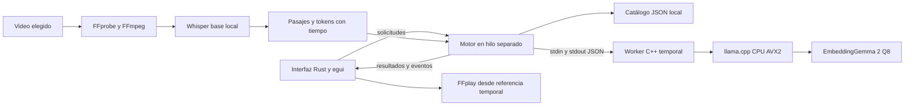

# Arquitectura actual y evolución propuesta

## Flujo implementado

No hay servidor HTTP. El proceso de embeddings carga DLL desde una carpeta conocida, codifica entradas y devuelve vectores normalizados. Las imágenes usan el mismo espacio vectorial con un proyector adicional. Los videos se buscan por embeddings de su transcripción, no por fotogramas ni embeddings de audio directo.

El ASR se ejecuta al importar y termina antes de cargar embeddings. Los resultados contienen pasaje/tiempo y se agrupan por archivo. Buscar no retranscribe. La sincronización revisa tamaño/fecha/versión; cambios de contenido que conserven exactamente esos metadatos pueden escapar a ese criterio. Añadir hashes es un trabajo futuro.

La demo pública genera rutas por clon. El catálogo personal es un archivo independiente. Persistencia, selección de colección y las referencias temporales se prueban con fixtures. Los originales no se modifican.

## Por qué existe el parche

El runtime de referencia es llama.cpp `b11461`. En `output_reserve`, una reserva incondicional de logits provoca memoria innecesaria para embeddings no causales. `patches/llama-no-logits.patch`, derivado de DigUp, evita esa reserva cuando la configuración pide embeddings y no usa atención causal. Con un vocabulario amplio, esta reserva puede costar aproximadamente 1 MiB por token. No sustituir el runtime por una versión arbitraria ni eliminar el parche sin medir paridad y memoria.

## Trabajo propuesto, aún no implementado

Inventario de nombres/metadatos → extracción con posición → SQLite/FTS5 y vectores en disco → recuperación híbrida → evaluación opcional de pocos candidatos. Cola persistente y observador para actualizar solo cambios. UI/modelos/extractores descargables con presupuestos de memoria por estado.

La búsqueda exacta sigue siendo referencia. ANN se elegiría solo cuando la escala y los benchmarks justifiquen la pérdida de exactitud y el coste de índice. A un millón de pasajes, 768 float32 por vector representan 3,072 GB sin texto ni índice; mantener el catálogo JSON completo en memoria no cumple el objetivo.

## Relación con DigUp

Se estudió [DigUp en el commit 6faa29e](https://github.com/ARahim3/DigUp/tree/6faa29e4c315a3a591de1b41bd78751bdf39588d), aplicación Swift/macOS que utiliza extracción, segmentos, SQLite/FTS5, embeddings y ubicaciones. Este prototipo reimplementa el flujo para Windows en Rust/egui y reutiliza la idea del parche de llama.cpp. No es una distribución oficial de DigUp ni comparte su grado de soporte de formatos.

La investigación original y los experimentos no se confunden con implementación. El estado real siempre está en [STATUS.md](STATUS.md), y la secuencia para continuar en [HANDOFF.md](HANDOFF.md).
